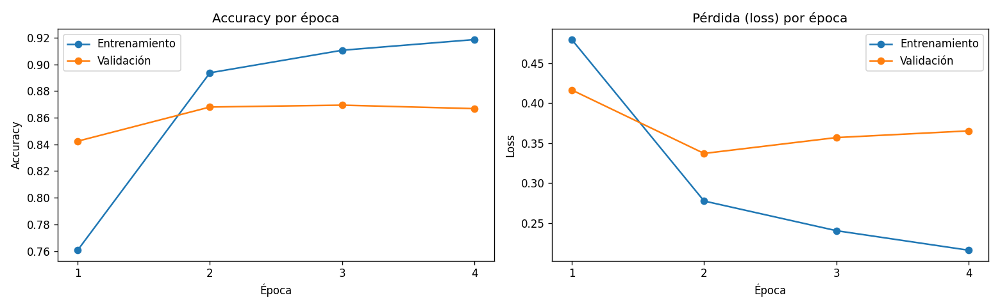
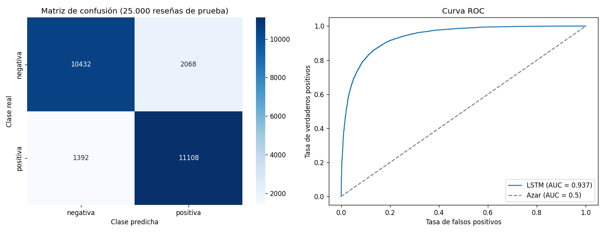

# Análisis de sentimiento con LSTM (IMDB)
**Repositorio:** https://github.com/PedroA-ClementeD/deep-learnig-rnn

Red neuronal recurrente LSTM entrenada en Google Colab para clasificar reseñas de películas como positivas o negativas. Incluye una aplicación en Streamlit donde se escribe una reseña nueva y el modelo devuelve su sentimiento con el nivel de confianza.

## Dataset

**IMDB Large Movie Review Dataset** (Maas et al., Universidad de Stanford, 2011). 50.000 reseñas de películas en inglés, balanceadas entre positivas y negativas. Viene incluido en Keras y se descarga solo al correr el notebook, por eso no está dentro del repositorio.

| Conjunto | Reseñas |
|---|---|
| Entrenamiento | 20.000 |
| Validación | 5.000 (20% del entrenamiento original, estratificado) |
| Prueba | 25.000 |

Se usan las 10.000 palabras más frecuentes y cada reseña se recorta o rellena a 200 palabras.

## Estructura del repositorio

```
├── notebooks/
│   └── lstm_imdb.ipynb      # Experimentación completa (Colab)
├── src/
│   ├── train.py             # Entrenamiento en script
│   └── predict.py           # Limpieza, codificación y predicción de un texto
├── models/
│   ├── lstm_imdb.keras      # Modelo entrenado
│   ├── vocabulario.json     # Palabra -> número, igual que en el entrenamiento
│   └── config.json          # Largo de secuencia y nombres de las clases
├── reports/                 # Gráficas y métricas generadas
├── app.py                   # Aplicación Streamlit
├── requirements.txt
└── README.md
```

## Resultados

| Métrica | Valor |
|---|---|
| Accuracy en prueba | 0.8616 |
| F1-Score | 0.8652 |
| AUC | 0.9374 |
| Épocas entrenadas | 4 (mejor: época 2) |




## Cómo ejecutarlo

### 1. Entrenar en Google Colab

1. Abre `notebooks/lstm_imdb.ipynb` en Colab.
2. Activa la GPU: **Entorno de ejecución → Cambiar tipo de entorno de ejecución → T4 GPU**.
3. Ejecuta todas las celdas (**Entorno de ejecución → Ejecutar todas**).
4. La celda de guardado descarga `resultados_lstm.zip`. Descomprímelo y copia su contenido a las carpetas `models/` y `reports/` del repositorio.
5. En Colab: **Archivo → Descargar → Descargar .ipynb** y reemplaza `notebooks/lstm_imdb.ipynb` con esa versión, que ya trae las salidas y las gráficas.

### 2. Instalar el entorno local

Requiere Python 3.12 o 3.13. Con Python 3.9 o anterior no se puede instalar TensorFlow 2.21, que es la versión con la que se entrenó el modelo. Para ver tu versión: `python --version`.

```bash
git clone https://github.com/PedroA-ClementeD/deep-learnig-rnn.git
cd deep-learnig-rnn

# Windows (indicando la versión de Python)
py -3.12 -m venv .venv
.venv\Scripts\activate

# Linux / macOS
python3.12 -m venv .venv
source .venv/bin/activate

pip install -r requirements.txt
```

### 3. Ejecutar la aplicación Streamlit

```bash
streamlit run app.py
```

Se abre en el navegador en `http://localhost:8501`. Escribe una reseña en inglés (o elige uno de los ejemplos) y pulsa **Analizar sentimiento**. La aplicación muestra si es positiva o negativa, la confianza y cuántas palabras no conoce el modelo.

### 4. Usar los scripts (opcional)

Entrenar sin el notebook. Deja el modelo en `models/` y las gráficas en `reports/`.

```bash
python src/train.py
python src/train.py --epocas 5
```

Predecir una reseña desde la terminal:

```bash
python src/predict.py "One of the best movies I have ever seen"
```

## Detalles del modelo

- **Preprocesamiento:** vocabulario de 10.000 palabras; secuencias de 200 palabras, recortando el inicio de las reseñas largas y rellenando con ceros al principio de las cortas. Los textos nuevos se pasan a minúsculas y se les quitan etiquetas HTML y signos de puntuación.
- **Arquitectura:** Embedding de 64 dimensiones, LSTM bidireccional de 64 unidades, Dropout del 50%, capa densa de 32 neuronas, Dropout del 30% y una salida sigmoid. 710.209 parámetros.
- **Entrenamiento:** Adam (tasa 0.001), binary crossentropy, hasta 10 épocas con EarlyStopping (paciencia 2).
- **Evaluación:** accuracy, precision, recall, F1, AUC, matriz de confusión y curva ROC sobre las 25.000 reseñas de prueba.

## Limitaciones

El modelo solo entiende inglés: en un texto en español casi todas las palabras quedan fuera del vocabulario. Tampoco conoce el sarcasmo ni las reseñas neutras, porque el dataset no incluye opiniones de 5 o 6 estrellas; ante una opinión tibia igual va a elegir positiva o negativa.
También falla más con textos muy cortos: "I didn't like it at all" lo clasificó como positiva.
